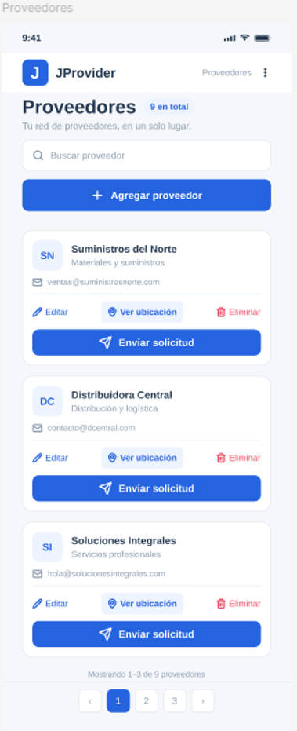

# JProvider - Sistema de Gestión de Proveedores

## Integrante
*   **Nombre:** José Pablo Ríos Brenes

## Descripción del Proyecto
JProvider es una aplicación móvil cuyo propósito es centralizar, clasificar y geolocalizar la información de contacto y logística
de las distintas marcas y empresas proveedoras de inventario. Para facilitar la identificación rápida en la operación diaria,
el sistema asocia a cada registro la identidad visual de la marca del producto que suministran (mediante foto de etiqueta o logotipo),
permitiendo tomar decisiones inmediatas de reabastecimiento.

## Diseño de la Interfaz (Prototipo)

  
  
  
  

